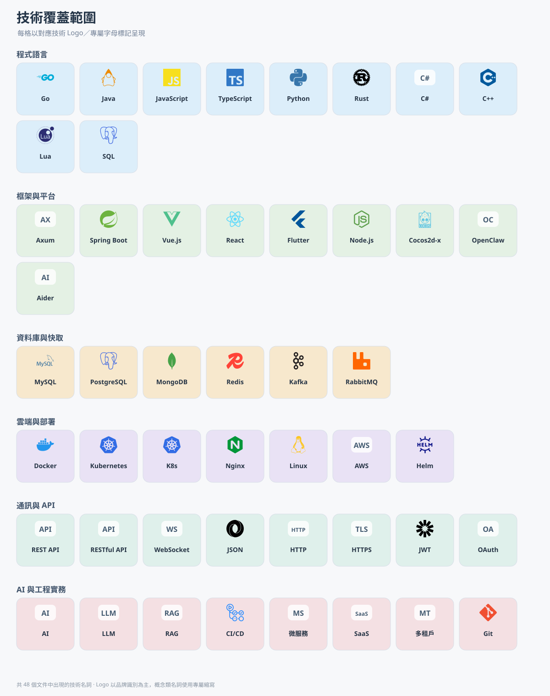

# Repository 索引

此索引彙整本目錄內各 repository 的簡介與文件位置。簡介依各專案 README／文件整理；未找到明確說明時以「待確認」標示。

> 彙整例外：`javatest` 與 `javatrst` 不建立 repo 說明文件，也不列入本索引。

| Repository | 簡介 | 專案文件 |
|---|---|---|
| [JustProject](./JustProject/README.md) | JIRA 風格的私人專案管理系統重製版 | [README](JustProject/README.md) |
| [Just_work](./Just_work/README.md) | AI 驅動的自動化專案開發系統 | [README](Just_work/README.md) |
| [Nice_Speak](./Nice_Speak/docs/Document/README.md) | 語音學習平台；文件包含架構、使用流程與等級設計 | [文件](Nice_Speak/docs/Document/README.md) |
| [QunyiTickserver](./QunyiTickserver/README.md) | 接收群益行情報價並轉送至自建伺服器 | [README](QunyiTickserver/README.md) |
| [TickServer](./TickServer/README.md) | 期貨 Tick 資料收發服務 | [README](TickServer/README.md) |
| [aider_deploy](./aider_deploy/README.md) | Aider 部署文件 | [README](aider_deploy/README.md) |
| [aider_project_start](./aider_project_start/README.md) | Aider 專案啟動與任務執行工具 | [README](aider_project_start/README.md) |
| [coffee](./coffee/README.md) | 多租戶咖啡館管理系統 | [README](coffee/README.md) |
| [fastIM](./fastIM/README.md) | 私人即時通訊系統 | [README](fastIM/README.md) |
| [fgsgame](./fgsgame/README.md) | 棋牌遊戲專案，使用 Cocos2d-x、Lua 與 Python | [README](fgsgame/README.md) |
| [java_account](./java_account/README.md) | 遊戲平台帳務系統；包含 Zuul Gateway、平台服務與財務服務 | [系統說明](java_account/README.md) · [架構](java_account/ARCHITECTURE.md) |
| [justread](./justread/docs/README.md) | 閱讀平台 | [文件](justread/docs/README.md) |
| [openclaw_extend_k8s_worker_dispatch](./openclaw_extend_k8s_worker_dispatch/README.md) | OpenClaw 使用的 Kubernetes Worker 調度系統 | [README](openclaw_extend_k8s_worker_dispatch/README.md) |
| [openclaw_extend_memory_system](./openclaw_extend_memory_system/README.md) | OpenClaw Gateway／Worker 的擴充記憶與任務執行系統 | [README](openclaw_extend_memory_system/README.md) |
| [openclaw_memory_qianqian](./openclaw_memory_qianqian/README.md) | OpenClaw 共用記憶 | [README](openclaw_memory_qianqian/README.md) |
| [openclaw_restruct](./openclaw_restruct/README.md) | OpenClaw 效能、多工與管理功能擴充 | [README](openclaw_restruct/README.md) |
| [rust_blackjack](./rust_blackjack/README.md) | Rust 多平台 Blackjack／21 點遊戲 | [README](rust_blackjack/README.md) |
| [speak](./speak/README.md) | 英語口說練習用途 repository；細節未詳 | [README](speak/README.md) |
| [stock](./stock/README.md) | 多租戶進銷存管理系統 | [README](stock/README.md) |
| [strategy_admin](./strategy_admin/README.md) | 圖靈策略交易平台管理後台 | [README](strategy_admin/README.md) |
| [strategy_backend](./strategy_backend/README.md) | 圖靈策略交易驗證平台後端 | [README](strategy_backend/README.md) |
| [strategy_front](./strategy_front/README.md) | 圖靈策略交易驗證平台前端 | [README](strategy_front/README.md) |
| [strategy_turning](./strategy_turning/README.md) | 圖靈策略交易系統；此目錄 README 的描述欄位內容與專案簡介不一致，索引採其目錄中的策略系統說明文件 | [README](strategy_turning/README.md) |
| [strategy_util](./strategy_util/README.md) | 策略系統排程及重啟後工具 | [README](strategy_util/README.md) |
| [strategytrade](./strategytrade/README.md) | 商品策略即時交易引擎 | [README](strategytrade/README.md) |

## 作品展示

以下兩個目錄是作品展示素材，不列為 repository 索引項目：

- **C#**：展示圖片集。
- **Cocos-2dx**：包含「捕魚」作品的展示圖片。

### C# 展示

### Cocos-2dx「捕魚」展示

> 本目錄文件是彙整副本，不代表已核實各遠端 repository 的最新狀態。
