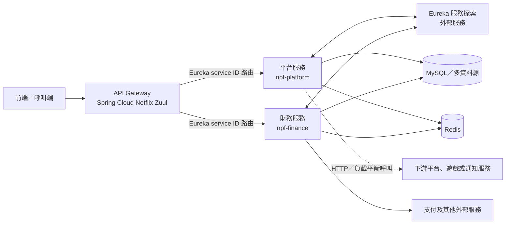

# java_account 系統說明

> 本目錄是 `java_account` 的文件彙整副本，只包含說明文件，不包含服務原始碼、執行檔或環境設定。架構描述依來源 monorepo 的 README、Maven 設定與程式結構整理；未在此重新驗證所有 API、部署或外部系統行為。

## 專案概覽

`java_account` 是遊戲平台帳務系統，由三個各自建置與啟動的 Java／Maven Spring Boot 專案組成。三者共用一個 Git monorepo，但不是同一個 Maven 多模組專案。

| 專案目錄 | Maven artifact | Spring Boot 啟動類別 | 主要職責 |
|---|---|---|---|
| `npf-gateway/` | `npf-gateway` | `com.sp.gateway.GatewayApplication` | Zuul API Gateway；依設定路由請求，並執行認證、IP 限制、維護狀態等前置處理。 |
| `new_tk1907/` | `npf-platform` | `com.sp.platform.PlatformApplication` | 平台管理、會員與遊戲相關 API、業務服務、資料存取及排程。 |
| `finace1907/` | `npf-finance` | `com.sp.financial.PaymentApplication` | 財務與帳務服務，涵蓋存提款、交易、帳戶、支付、報表及管理功能。 |

`finace1907` 是來源專案目前使用的目錄拼法。各服務都有自己的 `pom.xml`、啟動類別及環境設定，需分別建置。

## 系統架構



請求通常由 Gateway 進入，按路由設定轉送至平台或財務服務。兩個業務服務以 Controller／Service／DAO 等分層處理請求，並透過 MySQL、Redis、本地共用 JAR 與外部服務完成業務流程。細節請見[系統架構](ARCHITECTURE.md)。

## 技術基線

- Java：三個 Maven 專案均指定 Java 8。
- 建置：Maven；各服務獨立建置。
- 框架：Gateway 使用 Spring Boot 2.0.2；平台與財務服務使用 Spring Boot 2.1.0。
- 服務探索與路由：Eureka client；Gateway 使用 Zuul。
- 資料與快取：MySQL、Redis。
- 其他依賴：可見 Spring Cloud Sleuth／Zipkin、Hystrix、Springfox Swagger；實際功能依各服務設定而異。
- 部分相依套件以 `src/lib` 下的本地 JAR 提供，例如 `npf-db`、`npf-commons`。

## 建置方式

需準備相容的 JDK 8、Maven、本地 JAR，以及各服務所需的安全環境設定與相依服務：

```bash
mvn -f npf-gateway/pom.xml clean package
mvn -f new_tk1907/pom.xml clean package
mvn -f finace1907/pom.xml clean package
```

上述指令是依各專案 `pom.xml` 整理的建置方式，不代表本文件副本包含程式碼，也不代表已在此環境完成建置或部署驗證。

## 安全與限制

- 不要將資料庫密碼、Token、私鑰、支付／簡訊金鑰或正式環境位址放入版本庫。
- 執行環境設定應由受控外部設定或安全憑證管理方式提供。
- 本文件刻意不複製原始環境設定與含敏感資料的程式碼。
- 根目錄以外的 Eureka、資料庫、Redis、支付及其他下游系統不包含在此文件目錄內。
- 本文件不是正式 API 契約、資料字典或部署手冊。

## 文件

- [系統架構與資料流](ARCHITECTURE.md)
- [文件彙整紀錄](DEVELOPMENT_LOG.md)
- [本次工作清單](TASKS.txt)
